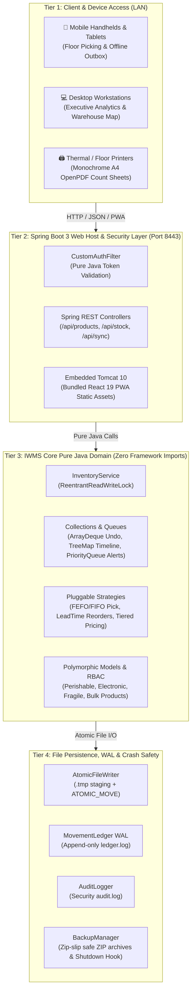
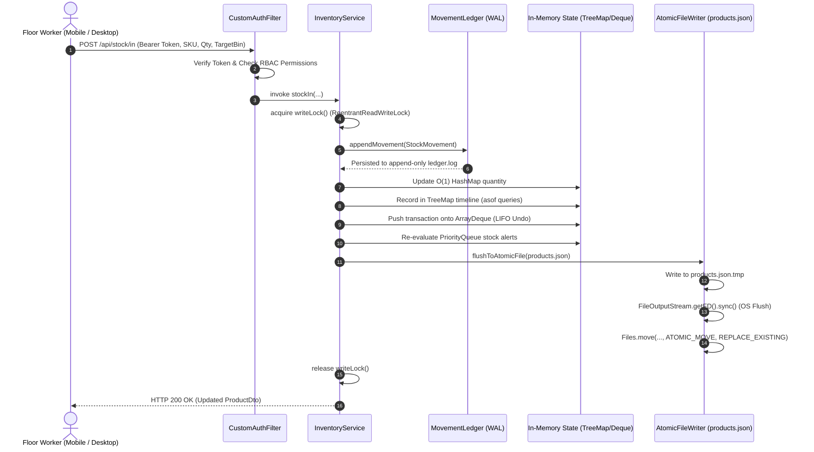
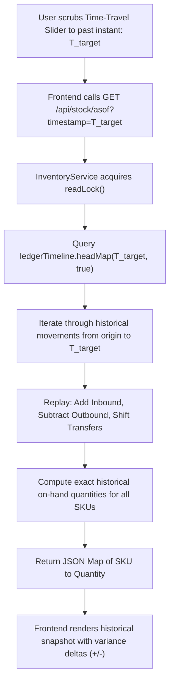
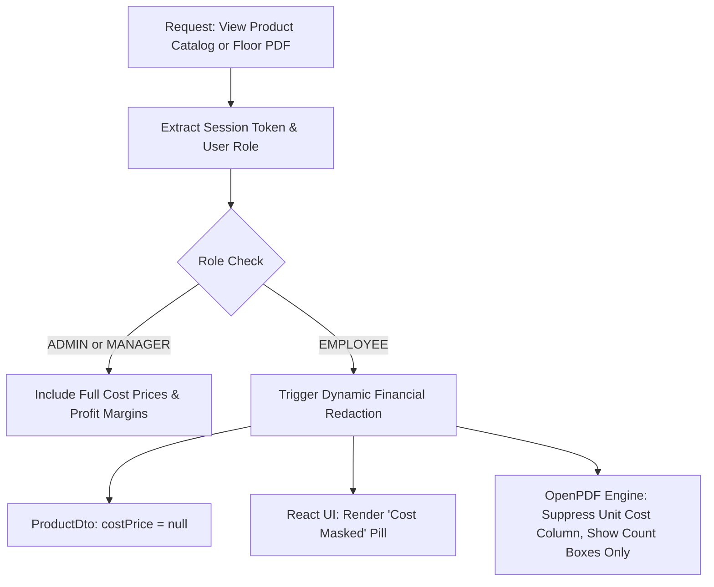

# Inventory & Warehouse Management System (IWMS)

[](https://www.oracle.com/java/)
[](https://spring.io/projects/spring-boot)
[](https://react.dev/)
[](https://vitejs.dev/)
[](https://tailwindcss.com/)
[-brightgreen)](https://github.com/Subhomoy-byte/Inventory-Management-System)
[-blue)](LICENSE)

An offline-capable, LAN-accessible Inventory and Warehouse Management System engineered to run on any local computer or on-premise server and serve mobile floor workers, warehouse terminals, and desktop workstations over a Local Area Network (LAN) — **with zero external SQL database requirements, zero cloud dependencies, and 100% free open-source software ($0 cost).**

Packaged as a single self-contained executable JAR (`java -jar iwms.jar`), IWMS demonstrates academic Java Object-Oriented Programming (OOP) principles, concurrency control, custom persistence engines, cryptographic security, and offline Progressive Web App (PWA) synchronization.

---

## Table of Contents
1. [Introduction & Problem Statement](#1-introduction--problem-statement)
2. [Visual System Architecture](#2-visual-system-architecture)
3. [Colourful Graphic Detailed Workflows](#3-colourful-graphic-detailed-workflows)
   - [Workflow A: Complete Stock Movement & Persistence Lifecycle](#workflow-a-complete-stock-movement--persistence-lifecycle)
   - [Workflow B: PWA Offline Outbox & LAN Auto-Sync Engine](#workflow-b-pwa-offline-outbox--lan-auto-sync-engine)
   - [Workflow C: Time-Travel Inventory Reconstruction (`TreeMap.headMap`)](#workflow-c-time-travel-inventory-reconstruction-treemapheadmap)
   - [Workflow D: Dynamic RBAC Financial Masking & Price Redaction](#workflow-d-dynamic-rbac-financial-masking--price-redaction)
4. [Step-by-Step Setup Guide on Any Device](#4-step-by-step-setup-guide-on-any-device)
   - [Step 1: Check System Requirements](#step-1-check-system-requirements)
   - [Step 2: Download or Clone the Repository](#step-2-download-or-clone-the-repository)
   - [Step 3: Build & Package (Single Command)](#step-3-build--package-single-command)
   - [Step 4: Launch the Server](#step-4-launch-the-server)
   - [Step 5: Access the Web Application](#step-5-access-the-web-application)
   - [Step 6: Connect Mobile Phones & Tablets over LAN](#step-6-connect-mobile-phones--tablets-over-lan)
   - [Step 7: Testing the Offline Mode & Outbox Auto-Sync](#step-7-testing-the-offline-mode--outbox-auto-sync)
5. [Pre-Seeded Demo User Profiles](#5-pre-seeded-demo-user-profiles)
6. [Academic Java OOP & CS Concept Mapping](#6-academic-java-oop--cs-concept-mapping)
7. [Comprehensive REST API Reference](#7-comprehensive-rest-api-reference)
8. [Automated Verification & Test Suite](#8-automated-verification--test-suite)
9. [Troubleshooting & FAQ](#9-troubleshooting--faq)
10. [Cloud & Vercel Deployment ($0 Free Hosting)](#10-cloud--vercel-deployment-0-free-hosting)

---

## 1. Introduction & Problem Statement

### The Real-World Challenge
Modern supply chains, logistics facilities, wholesale distribution depots, and remote construction storehouses share a critical vulnerability: **reliance on constant internet connectivity and costly database infrastructures.**
- Concrete and steel warehouse construction often creates **Wi-Fi dead zones** where cloud-dependent applications fail completely.
- Commercial warehouse software requires expensive recurring subscriptions, cloud databases (PostgreSQL, Oracle, MySQL), dedicated database administrators, and complex container orchestration.
- When the internet goes down, warehouse floor picking, receiving, and dispatch operations grind to a halt.

### The IWMS Solution
IWMS was designed from the ground up to solve these problems while costing **exactly $0.00**:
- **100% Free & Self-Contained:** Zero database servers, zero cloud bills, zero API fees. Runs directly on the JVM using plain files (`java.nio.file`).
- **Offline-First PWA Architecture:** Floor workers can walk into Wi-Fi dead zones, record Stock In, Stock Out, or Bin Transfers on mobile devices. The app safely queues actions in browser IndexedDB and automatically syncs with the server the instant Wi-Fi reconnects.
- **Pure Java Domain Integrity:** The core business rules, algorithms, and persistence engines are written in pure Java 17 with **zero Spring Framework or Jakarta dependencies**.
- **Industrial Crash Safety:** Uses a temporary-file staging engine with OS disk cache flushes (`FileOutputStream.getFD().sync()`), atomic renames (`ATOMIC_MOVE`), append-only Write-Ahead Logs (WAL), and automated zip-slip-safe ZIP backups.
- **Physical Floor Count Tooling:** Direct in-browser generation and preview of monochrome A4 physical count sheets with physical count entry boxes, employee signature blocks, and role-based cost price masking.

---

## 2. Visual System Architecture

IWMS is structured into four decoupled architectural tiers:




---

## 3. Colourful Graphic Detailed Workflows

### Workflow A: Complete Stock Movement & Persistence Lifecycle

Every stock transaction (Inbound, Outbound, Transfer, or Adjustment) follows a strict ACID-compliant pipeline:




---

### Workflow B: PWA Offline Outbox & LAN Auto-Sync Engine

When warehouse floor staff enter areas without Wi-Fi coverage, the app switches to offline queueing without interrupting work:


```mermaid
flowchart LR
    subgraph MobileDevice["Mobile Tablet / Scanner"]
        A["Worker Records Movement"] --> B{"Is Network Online?"}
        B -->|Yes| C["Send Directly to REST API<br/>POST /api/stock/in"]
        B -->|No| D["Generate Unique syncId"]
        D --> E["Queue into IndexedDB 'outbox'"]
        E --> F["Optimistically Update Local Stock Display"]
        F --> G["Increment Floating Dock Badge (+1)"]
        G --> H["Network Reconnected Event<br/>window.addEventListener('online')"]
        H --> I["Drain Outbox Batch<br/>POST /api/sync/batch"]
    end

    subgraph Server["IWMS Spring Boot Host"]
        I --> J["SyncEngine.processBatch(...)"]
        J --> K{"Is syncId Duplicate?"}
        K -->|Yes| L["Ignore Idempotently"]
        K -->|No| M{"Does Stock Meet Demand?"}
        M -->|Yes| N["Append to WAL &amp; Commit"]
        M -->|No (Deficit)| O["Record into SyncConflict Registry"]
        N --> P["HTTP 200 OK Response"]
        O --> P
    end

    P --> Q["Clear Synced Items from IndexedDB"]
    O --> R["Surfaced in Manager Conflict Review Panel"]
```

---

### Workflow C: Time-Travel Inventory Reconstruction (`TreeMap.headMap`)

How IWMS reconstructs historical inventory levels at any historical second without storing redundant snapshot tables:



---

### Workflow D: Dynamic RBAC Financial Masking & Price Redaction

Security enforcement operates at the domain, controller, and reporting layers to safeguard commercial margins:



---

## 4. Step-by-Step Setup Guide on Any Device

Follow these instructions to run IWMS on any computer (Windows, macOS, or Linux).


### Step 1: Check System Requirements
IWMS requires only the standard Java Runtime Environment:
- **Java:** JDK 17, 21, or 26 installed.
- Check by opening a terminal / command prompt:
  ```bash
  java -version
  ```
  *If Java is not installed, download the free OpenJDK from [adoptium.net](https://adoptium.net/).*

---

### Step 2: Download or Clone the Repository
On the target machine, clone the repository:
```bash
git clone https://github.com/Subhomoy-byte/Inventory-Management-System.git
cd Inventory-Management-System
```

---

### Step 3: Build & Package (Single Command)
Run Maven to build the multi-module project and package the fat JAR:

- **Windows (PowerShell or CMD):**
  ```powershell
  .\mvnw.cmd clean package
  ```
- **macOS / Linux:**
  ```bash
  ./mvnw clean package
  ```

*(If you have Maven installed globally, you can simply run `mvn clean package`)*

This compiles all pure Java classes, runs all 44 unit and integration tests, and packages the entire Spring Boot host and React PWA into a single fat JAR:
```
iwms-web/target/iwms.jar  (~25 MB)
```

---

### Step 4: Launch the Server
Execute the JAR with a single command:
```bash
java -jar iwms-web/target/iwms.jar
```

In approximately 5 to 6 seconds, you will see the Spring Boot banner:
```
  .   ____          _            __ _ _
 /\\ / ___'_ __ _ _(_)_ __  __ _ \ \ \ \
( ( )\___ | '_ | '_| | '_ \/ _` | \ \ \ \
 \\/  ___)| |_)| | | | | || (_| |  ) ) ) )
  '  |____| .__|_| |_|_| |_\__, | / / / /
 =========|_|==============|___/=/_/_/_/
 :: Spring Boot ::                (v3.2.5)

Tomcat started on port 8443 (http) with context path ''
Started IwmsApplication in 5.8 seconds
```

---

### Step 5: Access the Web Application
Open any web browser on the host machine and visit:
```
http://localhost:8443
```
You will be greeted by the Glassmorphism Login Screen with pre-configured 1-click demo login buttons.

---

### Step 6: Connect Mobile Phones & Tablets over LAN
To use IWMS on warehouse tablets, smartphones, or mobile barcode scanners:

1. **Find the Host Computer's Local IP:**
   - **Windows:** Run `ipconfig` (look for `IPv4 Address`, e.g., `192.168.1.50`).
   - **macOS / Linux:** Run `ifconfig` or `ip a` (e.g., `192.168.1.50`).

2. **Connect the Mobile Device:**
   - Connect the phone/tablet to the **same Wi-Fi network** as the host computer.
   - Open Chrome, Safari, or Firefox on the phone and navigate to:
     ```
     http://<HOST_IP>:8443
     ```
     *(Example: `http://192.168.1.50:8443`)*

3. **Install as a Standalone App (PWA):**
   - **Android Chrome:** Tap the browser menu `⋮` &rarr; select **"Add to Home Screen"** or **"Install App"**.
   - **iOS Safari:** Tap the Share button &rarr; select **"Add to Home Screen"**.
   - The app now launches in full-screen native mode without browser address bars!

---

### Step 7: Testing the Offline Mode & Outbox Auto-Sync
You can test the offline capabilities in 30 seconds:

1. On your mobile phone or browser, log in as `employee` (`emp123`).
2. Turn on **Airplane Mode** (or disconnect your Wi-Fi).
3. Notice the top status badge instantly changes to **"Offline Mode" (Amber Pulse)**.
4. Record several stock movements (e.g., Stock In 25 units of SKU `PROD-ELEC-001`).
5. Open the **Sync Outbox** tab on the dock &mdash; see your pending transactions queued in browser IndexedDB.
6. Turn **Airplane Mode OFF** (reconnect Wi-Fi).
7. Notice the badge turns green (**"LAN Online"**) and the system automatically flushes the queue to the server with zero manual intervention!

---

## 5. Pre-Seeded Demo User Profiles

On startup, IWMS automatically provisions three user profiles:

| Role | Username | Password | System Privileges & Permissions |
| :--- | :--- | :--- | :--- |
| **Admin** | `admin` | `admin123` | **Full Unrestricted Control:** Full access to all catalog products, cost prices, profit margins, user lockouts, ZIP backups, and administrative settings. |
| **Manager** | `manager` | `manager123` | **Warehouse Management:** Stock operations, purchase order creation/receiving, cycle count reconciliation, conflict review, floor reports with financial columns. |
| **Employee** | `employee` | `emp123` | **Floor Operations:** Stock In/Out/Transfer, physical floor counts. **Strictly Redacted:** Cost prices and profit margins are masked across all screens, API responses, and generated PDF reports. |

> **Tip:** The Login screen features 1-click quick-fill buttons for each role.

---

## 6. Academic Java OOP & CS Concept Mapping

This codebase is specifically architected to serve as a textbook-quality showcase of Java Object-Oriented Programming and Computer Science algorithms:

| Java & CS Concept | Exact File Location | Architectural Implementation & Highlights |
| :--- | :--- | :--- |
| **Encapsulation** | [`com.iwms.model.Product`](iwms-core/src/main/java/com/iwms/model/Product.java)<br>[`Batch`](iwms-core/src/main/java/com/iwms/model/Batch.java) | All fields private; validation in constructors/setters; immutable [`StockMovement`](iwms-core/src/main/java/com/iwms/model/StockMovement.java); unmodifiable collection views |
| **Abstraction** | [`com.iwms.model.Product`](iwms-core/src/main/java/com/iwms/model/Product.java) | Abstract class declaring abstract methods (`calculateStorageCost()`, `getHandlingRules()`) |
| **Inheritance & Polymorphism** | [`PerishableProduct`](iwms-core/src/main/java/com/iwms/model/PerishableProduct.java)<br>[`ElectronicProduct`](iwms-core/src/main/java/com/iwms/model/ElectronicProduct.java)<br>[`FragileProduct`](iwms-core/src/main/java/com/iwms/model/FragileProduct.java)<br>[`BulkProduct`](iwms-core/src/main/java/com/iwms/model/BulkProduct.java) | Subclasses overriding storage cost calculation and specialized handling rules |
| **Builder Design Pattern** | [`Product.ProductBuilder`](iwms-core/src/main/java/com/iwms/model/Product.java) | Fluent recursive builder pattern enforcing parameter validation |
| **Strategy Design Pattern** | [`PickStrategy`](iwms-core/src/main/java/com/iwms/service/PickStrategy.java)<br>[`AlertStrategy`](iwms-core/src/main/java/com/iwms/service/AlertStrategy.java)<br>[`ReorderStrategy`](iwms-core/src/main/java/com/iwms/service/ReorderStrategy.java)<br>[`PricingStrategy`](iwms-core/src/main/java/com/iwms/service/PricingStrategy.java) | Pluggable strategy algorithms with runtime substitution |
| **Interfaces with 2+ Impls** | Strategy implementations | [`FefoPickStrategy`](iwms-core/src/main/java/com/iwms/service/FefoPickStrategy.java) vs [`FifoPickStrategy`](iwms-core/src/main/java/com/iwms/service/FifoPickStrategy.java); [`LowStockAlertStrategy`](iwms-core/src/main/java/com/iwms/service/LowStockAlertStrategy.java) vs [`ExpiringBatchAlertStrategy`](iwms-core/src/main/java/com/iwms/service/ExpiringBatchAlertStrategy.java); [`MinMaxReorderStrategy`](iwms-core/src/main/java/com/iwms/service/MinMaxReorderStrategy.java) vs [`VelocityReorderStrategy`](iwms-core/src/main/java/com/iwms/service/VelocityReorderStrategy.java); [`AverageCostPricingStrategy`](iwms-core/src/main/java/com/iwms/service/AverageCostPricingStrategy.java) vs [`FifoPricingStrategy`](iwms-core/src/main/java/com/iwms/service/FifoPricingStrategy.java) |
| **Domain Interfaces** | [`Storable`](iwms-core/src/main/java/com/iwms/model/Storable.java)<br>[`Auditable`](iwms-core/src/main/java/com/iwms/model/Auditable.java)<br>[`Exportable`](iwms-core/src/main/java/com/iwms/model/Exportable.java) | Behavioral contracts for storage metrics, tamper-evident audit strings, and CSV serialization |
| **Java Collections** | [`InventoryService`](iwms-core/src/main/java/com/iwms/service/InventoryService.java) | `HashMap` for O(1) catalog/bins; `TreeMap` for time-travel ledger (`headMap`); `ArrayDeque` for LIFO undo stack; `PriorityQueue` for alert urgency; `LinkedHashMap` for LRU cache |
| **Concurrency** | [`InventoryService`](iwms-core/src/main/java/com/iwms/service/InventoryService.java) | `ReentrantReadWriteLock` with separate readLock for concurrent floor readers and writeLock for atomic stock transitions |
| **Streams & Lambdas** | [`InventoryService`](iwms-core/src/main/java/com/iwms/service/InventoryService.java) | `Collectors.groupingBy`, `summingDouble`, `summingInt`, `flatMap`, custom comparator sorting for valuations |
| **Repository Pattern** | [`Repository`](iwms-core/src/main/java/com/iwms/repository/Repository.java)<br>[`FileBackedRepository`](iwms-core/src/main/java/com/iwms/repository/FileBackedRepository.java) | Generic repository abstraction with in-memory concurrent caching and atomic JSON file persistence with polymorphic deserialization |
| **Atomic File Persistence** | [`AtomicFileWriter`](iwms-core/src/main/java/com/iwms/storage/AtomicFileWriter.java) | Prevents corruption via `.tmp` staging, OS disk cache sync (`getFD().sync()`), and atomic rename (`ATOMIC_MOVE`) |
| **Write-Ahead Log (WAL)** | [`MovementLedger`](iwms-core/src/main/java/com/iwms/storage/MovementLedger.java) | Append-only sequential TSV log for immutable stock movements and crash-recovery state replay |
| **Audit Logging** | [`AuditLogger`](iwms-core/src/main/java/com/iwms/storage/AuditLogger.java) | Append-only security and operational audit trail tracking actor, action, target, outcome, and metadata |
| **Backup & Recovery** | [`BackupManager`](iwms-core/src/main/java/com/iwms/storage/BackupManager.java) | Automated and on-demand compressed ZIP backups of `data/`, zip-slip prevention, and JVM shutdown hook |
| **Data Seeder** | [`DataSeeder`](iwms-core/src/main/java/com/iwms/storage/DataSeeder.java) | Idempotent bootstrap seeding of warehouse topology (Warehouse -> Zones -> Bins) and >200 realistic products with initial stock |
| **User Hierarchy & RBAC** | [`User`](iwms-core/src/main/java/com/iwms/model/User.java)<br>[`AdminUser`](iwms-core/src/main/java/com/iwms/model/AdminUser.java)<br>[`ManagerUser`](iwms-core/src/main/java/com/iwms/model/ManagerUser.java)<br>[`EmployeeUser`](iwms-core/src/main/java/com/iwms/model/EmployeeUser.java) | Polymorphic permissions using high-performance `EnumSet<Permission>`; employee role strictly masks financial costs and margins |
| **PBKDF2 Cryptography** | [`Pbkdf2Authenticator`](iwms-core/src/main/java/com/iwms/auth/Pbkdf2Authenticator.java) | `PBKDF2WithHmacSHA256` (100,000 iterations, 16-byte salt, constant-time compare, 5-attempt automatic 15-minute account lockout) |
| **Session Management** | [`SessionManager`](iwms-core/src/main/java/com/iwms/auth/SessionManager.java) | Cryptographically secure 32-byte URL-safe tokens, 8-hour sliding window expiry, and immediate revocation |
| **Offline Sync Engine** | [`SyncEngine`](iwms-core/src/main/java/com/iwms/sync/SyncEngine.java) | Idempotent deduplication of queued client actions via `syncId`, automated conflict logging on inventory deficits for manager resolution |
| **OpenPDF Floor Reports** | [`PdfReportGenerator`](iwms-core/src/main/java/com/iwms/report/PdfReportGenerator.java) | High-contrast monochrome A4 physical count sheets with physical count boxes, signature blocks, and dynamic RBAC price redaction |
| **CSV Catalog Exporter** | [`CsvReportGenerator`](iwms-core/src/main/java/com/iwms/report/CsvReportGenerator.java) | Product catalog CSV export with role-aware cost price masking and CSV parsing round-trip |
| **REST API & Web Host** | [`com.iwms.api.controller.*`](iwms-web/src/main/java/com/iwms/api/controller/) | Spring Boot 3 controllers for Auth, Products, Stock In/Out/Transfer/Undo, Time-Travel, Warehouses, Sync, and Reports |
| **Lightweight Custom Auth Filter** | [`CustomAuthFilter`](iwms-web/src/main/java/com/iwms/api/filter/CustomAuthFilter.java) | Pure Java token validation via `SessionManager` without heavy Spring Security dependency, binding context `User` |
| **Role-Aware DTO Projections** | [`ProductDto`](iwms-web/src/main/java/com/iwms/api/dto/ProductDto.java) | Dynamic field-level projection stripping sensitive `costPrice` and margin data for `EMPLOYEE` role clients |
| **Custom Domain Exceptions** | [`com.iwms.exception.*`](iwms-core/src/main/java/com/iwms/exception/) | Checked exceptions ([`InsufficientStockException`](iwms-core/src/main/java/com/iwms/exception/InsufficientStockException.java), [`DuplicateSkuException`](iwms-core/src/main/java/com/iwms/exception/DuplicateSkuException.java), [`StorageException`](iwms-core/src/main/java/com/iwms/exception/StorageException.java), [`SyncConflictException`](iwms-core/src/main/java/com/iwms/exception/SyncConflictException.java)) and unchecked exceptions ([`UnauthorizedException`](iwms-core/src/main/java/com/iwms/exception/UnauthorizedException.java), [`ForbiddenException`](iwms-core/src/main/java/com/iwms/exception/ForbiddenException.java)) |
| **Glassmorphism UI Shell** | [`App.tsx`](iwms-ui/src/App.tsx)<br>[`index.css`](iwms-ui/src/index.css) | Frosted glass containers (`backdrop-blur-xl`), animated gradient mesh, responsive layout, dark/light theme |
| **Floating Glass Dock** | [`Dock.tsx`](iwms-ui/src/components/layout/Dock.tsx) | macOS-inspired floating navigation dock with tooltips, active tab scaling, and pending sync count badges |
| **Client-Side RBAC & Quick Login** | [`LoginPage.tsx`](iwms-ui/src/pages/LoginPage.tsx)<br>[`AuthContext.tsx`](iwms-ui/src/context/AuthContext.tsx) | Responsive login screen with 1-click Admin, Manager, and Employee credential fillers, secure token storage |
| **PWA Offline Storage & Sync Engine** | [`db.ts`](iwms-ui/src/storage/db.ts)<br>[`sync.ts`](iwms-ui/src/storage/sync.ts) | IndexedDB (`idb`) outbox queue, optimistic offline stock mutations, automated LAN reconnect flush, deficit conflict triage |
| **2D Warehouse Topology Map** | [`WarehouseMapPage.tsx`](iwms-ui/src/pages/WarehouseMapPage.tsx) | Interactive 2D floor grid visualizing Zones, Bins, utilization fill percentages, and item inspection drawer |
| **Real-time Inventory Management** | [`DashboardPage.tsx`](iwms-ui/src/pages/DashboardPage.tsx)<br>[`InventoryPage.tsx`](iwms-ui/src/pages/InventoryPage.tsx) | Recharts category analytics, low stock radar, glass data table with search, category/status filters, and stock In/Out/Transfer modal |
| **Time-Travel Ledger & LIFO Undo** | [`MovementsPage.tsx`](iwms-ui/src/pages/MovementsPage.tsx) | Scrubbable timeline querying `TreeMap.headMap()` for historical stock snapshots at any past minute; 1-click `ArrayDeque` undo |
| **Purchase Order Receiving** | [`OrdersPage.tsx`](iwms-ui/src/pages/OrdersPage.tsx) | PO creation, supplier tracking, expected delivery dates, and 1-click dock receiving with automatic stock-in mutations |
| **Guided Cycle Count & Reconciliation** | [`CycleCountPage.tsx`](iwms-ui/src/pages/CycleCountPage.tsx) | Physical floor audit sheet with instant surplus/deficit variance calculations and 1-click ledger reconciliation |
| **OpenPDF Live Preview & ZIP Backups** | [`ReportsPage.tsx`](iwms-ui/src/pages/ReportsPage.tsx) | In-browser preview of monochrome A4 count sheets, CSV downloads, and on-demand zip-slip-safe compressed backups |
| **Global Command Palette** | [`CommandPalette.tsx`](iwms-ui/src/components/CommandPalette.tsx) | `Ctrl + K` spotlight modal for instant keyboard navigation across all screens and rapid SKU search |

---

## 7. Comprehensive REST API Reference

All requests (except `/api/auth/login`) require the HTTP header:
```
Authorization: Bearer <session-token>
```

| Method | Endpoint | Description | Role Access |
| :--- | :--- | :--- | :--- |
| `POST` | `/api/auth/login` | Authenticate with username and password | Public |
| `POST` | `/api/auth/logout` | Invalidate active session token | Authenticated |
| `GET` | `/api/products` | Retrieve catalog (costs masked for Employee) | Authenticated |
| `GET` | `/api/products/{id}` | Retrieve single product details | Authenticated |
| `GET` | `/api/products/search?query=...` | Search catalog by SKU or title | Authenticated |
| `POST` | `/api/stock/in` | Record inbound stock arrival | Authenticated |
| `POST` | `/api/stock/out` | Record outbound stock dispatch | Authenticated |
| `POST` | `/api/stock/transfer` | Move inventory between bins | Authenticated |
| `POST` | `/api/stock/undo` | Undo the last stock movement via `ArrayDeque` | Manager, Admin |
| `GET` | `/api/stock/movements` | Retrieve sequential WAL movement ledger | Authenticated |
| `GET` | `/api/stock/asof?timestamp=...` | Query historical inventory snapshot via `TreeMap` | Authenticated |
| `GET` | `/api/warehouses` | Retrieve full facility topology (Zones &amp; Bins) | Authenticated |
| `POST` | `/api/sync/batch` | Idempotent batch processing of offline mutations | Authenticated |
| `GET` | `/api/sync/conflicts` | List unresolved deficit conflicts | Manager, Admin |
| `GET` | `/api/reports/summary.pdf` | Stream monochrome A4 floor count sheet PDF | Authenticated |
| `GET` | `/api/reports/catalog.csv` | Export catalog in standard CSV format | Authenticated |
| `POST` | `/api/backups/create` | Trigger on-demand compressed ZIP backup | Admin |

---

## 8. Automated Verification & Test Suite

IWMS maintains a **100% test pass rate across 44 unit and integration tests**:

```bash
mvn test
```

### Test Suite Summary
```
[INFO] -------------------------------------------------------
[INFO]  T E S T S
[INFO] -------------------------------------------------------
[INFO] Running com.iwms.auth.AuthAndSyncTest (6 tests - PASSED)
[INFO] Running com.iwms.model.ProductHierarchyTest (7 tests - PASSED)
[INFO] Running com.iwms.report.ReportGeneratorTest (3 tests - PASSED)
[INFO] Running com.iwms.service.InventoryServiceTest (8 tests - PASSED)
[INFO] Running com.iwms.service.StrategyTests (6 tests - PASSED)
[INFO] Running com.iwms.SmokeTest (1 test - PASSED)
[INFO] Running com.iwms.storage.FilePersistenceTest (6 tests - PASSED)
[INFO] Running com.iwms.api.ApiControllerTests (7 tests - PASSED)
[INFO] 
[INFO] Results:
[INFO] Tests run: 44, Failures: 0, Errors: 0, Skipped: 0
[INFO] BUILD SUCCESS
```

---

## 9. Troubleshooting & FAQ

#### Q: Port 8443 is already in use by another service. How can I change it?
**A:** You can override the port at launch using standard Spring Boot arguments:
```bash
java -jar iwms-web/target/iwms.jar --server.port=9090
```
Then access at `http://localhost:9090`.

#### Q: How does IWMS prevent data loss if the computer crashes or loses power?
**A:** IWMS uses a **Write-Ahead Log (WAL)** engine (`MovementLedger`). Every movement is written to `data/ledger.log` on disk before in-memory state is altered. Additionally, `AtomicFileWriter` writes to a `.tmp` file, calls `FileOutputStream.getFD().sync()` to force the OS kernel to flush disk controller buffers, and then performs an atomic replacement via `Files.move(..., ATOMIC_MOVE)`.

#### Q: Can I run this on a Raspberry Pi or low-power mini PC?
**A:** Yes! Because IWMS requires no external database engine and runs lightweight in-memory collections, it runs smoothly on single-board computers (Raspberry Pi 4/5) with 2GB+ RAM.

---

## 10. Cloud & Vercel Deployment ($0 Free Hosting)

IWMS can be deployed to the cloud for free ($0) in two ways:

### Option A: Deploy Frontend to Vercel (Interactive Demo / Web PWA)
Vercel is a global frontend and edge cloud platform. While Vercel does not run long-running Java virtual machines, **the React 19 PWA (`iwms-ui`) deploys seamlessly to Vercel in 1 click**:

1. **Import into Vercel:**
   - Go to [vercel.com](https://vercel.com) and log in.
   - Click **"Add New..."** &rarr; **"Project"**.
   - Select your repository: `Subhomoy-byte/Inventory-Management-System`.
2. **Flexible Root Directory (Zero Configuration):**
   - **Default (Root Directory: `./`):** The repository includes a root [`vercel.json`](vercel.json), root [`package.json`](package.json), and [`.npmrc`](.npmrc) configured with `--prefix iwms-ui` and `legacy-peer-deps=true`. You do not need to change anything!
   - **Alternative (Root Directory: `iwms-ui`):** If you prefer to set the Vercel Root Directory to `iwms-ui`, a localized [`iwms-ui/vercel.json`](iwms-ui/vercel.json) and [`iwms-ui/.npmrc`](iwms-ui/.npmrc) are also provided.
3. **Deploy:** Click **"Deploy"**.
   - Your live frontend URL (`https://inventory-management-system-xxx.vercel.app`) will be active in seconds!
   - **Standalone Demo Mode:** When running on Vercel without a backend connected, the PWA automatically uses its built-in browser IndexedDB database to populate demo inventory, allowing anyone on the internet to test the glassmorphism UI, 2D warehouse map, and cycle counts interactively!
   - *(Optional)* To connect your Vercel frontend to a live Java backend, set the environment variable in Vercel Project Settings &rarr; Environment Variables:
     ```
     VITE_API_BASE=https://your-iwms-backend.onrender.com/api
     ```

> [!TIP]
> **Vercel Troubleshooting (`BUILD_UTILS_SPAWN_1`):**
> If you previously had a failed build with `BUILD_UTILS_SPAWN_1`, go to the **Deployments** tab on Vercel, click the three dots (`...`) next to the deployment, and click **Redeploy** (ensure *"Use existing Build Cache"* is unchecked) to fetch the latest commit.

---

### Option B: Deploy Full-Stack (Java Backend + React Frontend) to Render ($0 Free)
To run the complete system (including the Spring Boot REST API, WAL persistence, and OpenPDF report generation) live on the web:

1. **Sign Up:** Go to [render.com](https://render.com) (free tier, $0/month).
2. **Create New Web Service:**
   - Click **"New +"** &rarr; **"Web Service"**.
   - Connect your GitHub repository: `Subhomoy-byte/Inventory-Management-System`.
3. **Configure Settings:**
   - **Environment:** Select **Docker** (Render will automatically detect the root [`Dockerfile`](Dockerfile)).
   - **Instance Type:** Select **Free ($0/month)**.
   - **Advanced &rarr; Add Environment Variable:**
     - Key: `PORT`
     - Value: `8443`
4. **Deploy:** Click **"Create Web Service"**.
   - Render will build the multi-stage Docker container (compiling the React frontend and Java backend together) and launch the live application at:
     ```
     https://your-service.onrender.com
     ```

---

## License
Open-source academic college project. Free for educational, commercial, and personal use under the MIT License.
